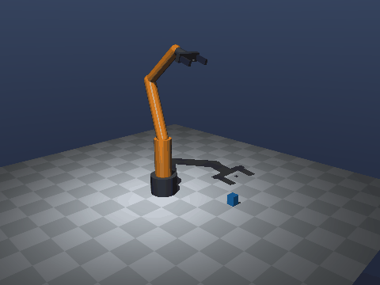
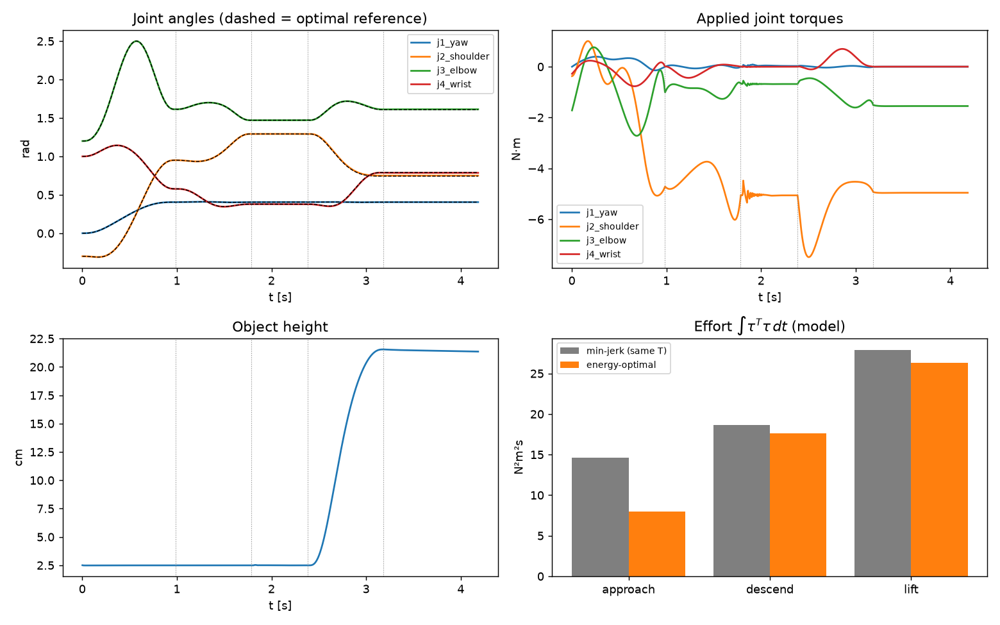

# Energy-Optimal Pick with a MuJoCo Manipulator

A 4-DOF arm with a parallel-jaw gripper picks up a box in MuJoCo. Every arm motion is planned as a
**free-final-time optimal control problem** that minimises actuator effort, using MuJoCo's inverse
dynamics inside the optimiser, and is then executed with a **computed-torque** tracking controller.

<p align="center"></p>

## Pipeline

```
IK way-points  ──►  energy-optimal trajectory (per segment)  ──►  computed-torque control  ──►  MuJoCo
 (pre-grasp,          min ∫ τᵀτ dt  over shape + final time          τ = M(q)(q̈ᵣ + K_d ė + K_p e) + h(q,q̇)
  grasp, lift)        s.t. dynamics, joint/torque limits,
                      Cartesian corridor for descend/lift
```

The task is split into: **approach → descend → grasp (close gripper) → lift → hold**.

## Optimal control formulation

For each segment from `q0` to `qf`:

$$
\min_{c,\,T}\; J = \int_0^T \tau(t)^\top \tau(t)\, dt
\quad \text{s.t.} \quad
\tau = M(q)\ddot q + C(q,\dot q)\dot q + g(q),\;\;
q_{\min} \le q \le q_{\max},\;\; |\tau| \le \tau_{\max}
$$

- **Effort cost** `∫ τᵀτ dt` is a standard proxy for electrical energy (copper losses ∝ τ²).
- **Parameterisation (direct method):** `q(s) = q0 + (qf − q0)·p5(s) + Σₖ cₖ φₖ(s)`, `s = t/T`, where `p5` is
  the minimum-jerk quintic and `φₖ(s) = 64 s³(1−s)³ sᵏ`. Each basis function has zero value, velocity and
  acceleration at both ends, so boundary conditions hold by construction.
- **Dynamics:** `τ(t)` is evaluated with `mujoco.mj_inverse` at collocation points (contacts disabled in the
  planning model). For the lift, the object's mass is added to the gripper so the plan is payload-aware.
- **Free final time:** `T` is a decision variable (bounded, multi-start since the problem is non-convex).
- **Constraints** (joint limits with margin, torque limits, and a 1 cm vertical corridor with the gripper pointing
  down during descend/lift) are enforced as penalties; solved with L-BFGS-B.

## Results

| Segment  | T* [s] | Effort, min-jerk (same T) | Effort, energy-optimal | Reduction |
|----------|-------:|--------------------------:|-----------------------:|----------:|
| approach | 0.98   | 14.58 N²m²s               | 7.94 N²m²s             | **45.5 %** |
| descend  | 0.80   | 18.62 N²m²s               | 17.63 N²m²s            | 5.3 %     |
| lift     | 0.80   | 27.90 N²m²s               | 26.28 N²m²s            | 5.8 %     |

Object lifted by 18.9 cm, max joint tracking error 0.47°. Measured effort in simulation matches the planned
effort to within ~1 %, which validates the inverse-dynamics model used in the optimiser.

**Observations**
- In the free-space approach the optimiser finds an interior optimal time (≈1 s): moving faster costs inertial
  torque, moving slower costs gravity-holding torque. It also folds the elbow mid-motion to shorten the
  gravity lever arm — a non-intuitive energy saving that a min-jerk profile misses.
- For the short vertical moves the path is fixed by the corridor, gravity dominates, and `T*` hits its lower bound;
  the remaining saving comes only from the timing profile.



## Run

```bash
pip install -r requirements.txt
python main.py               # interactive viewer (on macOS use: mjpython main.py)
python main.py --headless    # no viewer
python main.py --headless --video   # also writes results/pick.mp4 and results/pick.gif
```
Planning takes ~30–40 s on a laptop CPU. For offscreen video on a Linux server, set `MUJOCO_GL=egl` (or `osmesa`).

## Files

| File | Contents |
|------|----------|
| `model/arm.xml` | MJCF model: 4-DOF arm (yaw + 3 pitch), torque motors, position-controlled fingers, box |
| `kinematics.py` | Damped-least-squares IK for position + top-down approach axis |
| `trajopt.py` | Energy-optimal free-final-time trajectory optimisation via `mj_inverse` |
| `main.py` | Task planning, computed-torque controller, simulation, plots, video |

## Possible extensions
- Exact gradients (analytical derivatives / `mjd_` functions) or a direct-collocation NLP (CasADi/IPOPT) instead of finite differences.
- Joint-velocity-aware energy model (`∫ |τᵀq̇| dt` mechanical work, regenerative braking).
- Monte Carlo robustness study over object pose, mass and friction.
- Swap the model for a Franka Panda from MuJoCo Menagerie.
